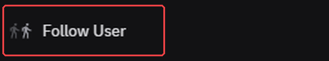
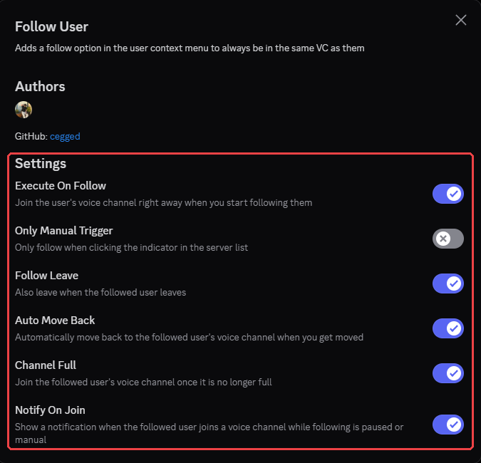

<div align="center">

# 🚶 Follow User

**Follow a friend from voice channel to voice channel, automatically.**

A [Vencord](https://github.com/Vendicated/Vencord) plugin that keeps you in the same voice channel as the user you follow.
When they hop to another channel, you hop with them.

[](LICENSE)
[](https://github.com/Vendicated/Vencord)

</div>

---

## Contents

- [Features](#-features)
- [Usage](#-usage)
- [Settings](#%EF%B8%8F-settings)
- [How it works](#-how-it-works)
- [Installation](#-installation)
- [Updating](#-updating)
- [FAQ](#-faq)
- [Author](#-author)
- [License](#-license)

---

## ✨ Features

| | |
|---|---|
| 🎧 **Auto follow** | Joins the voice channel of the user you follow whenever they move |
| 📍 **Server list indicator** | Shows who you follow, where they are, and lets you join in one click |
| ⏸️ **Smart pause** | Leaving their channel yourself pauses following, joining them again resumes it |
| 🔔 **Join notifications** | Get notified when they join a channel while following is paused |
| 🚪 **Follow leave** | Optionally disconnect when they disconnect |
| ↩️ **Auto move back** | Optionally go back to them when someone moves you to another channel |
| 👥 **Full channel watch** | Joins as soon as a spot opens up in their full channel |
| 🛡️ **Safe checks** | Never tries to join channels you have no permission for or that are full |

---

## 📖 Usage

### 1. Follow someone

Right-click any user (in chat, the member list or a voice channel) and choose **Follow User**.
If they are already in a voice channel, you join them right away.

To stop, right-click them again and choose **Unfollow User**.



> [!NOTE]
> You can follow one user at a time. Following someone new replaces the previous one.

### 2. The indicator

The user you follow appears at the top of your server list.

- 🟢 **Green badge**: they are in a voice channel and you are following them
- ⚫ **Grey badge**: they are not in a voice channel you can see, or following is paused
- 🌫️ **Greyed out avatar**: following is paused
- **Hover** to see their current channel and server
- **Click** to join them right now (this also resumes following if it was paused)


### 3. Indicator menu

Right-click the indicator for quick actions:

| Option | What it does |
|---|---|
| **Join Now** | Jumps into their channel (hidden when you are already together) |
| **Pause / Resume Following** | Temporarily stops following without forgetting the user |
| **Unfollow** | Stops following and removes the indicator |
| **Settings** | Opens the plugin settings |


---

## ⚙️ Settings

Open them from the indicator menu, or from **Vencord → Plugins → Follow User**.

| Setting | Default | Description |
|---|:---:|---|
| **Execute On Follow** | ✅ | Join their voice channel immediately when you start following |
| **Only Manual Trigger** | ❌ | Never move automatically, only when you click the indicator |
| **Follow Leave** | ❌ | Disconnect from voice when they disconnect |
| **Auto Move Back** | ❌ | Go back to their channel when someone moves you |
| **Channel Full** | ✅ | Join their channel once it is no longer full |
| **Notify On Join** | ✅ | Notify you when they join a channel while following is paused or manual. Click the notification to join |



---

## 🧠 How it works

- **Smart pause:** If you leave their channel on your own, the plugin assumes you wanted to leave and pauses following, so it won't drag you back on their next move. Join their channel again (or click the indicator) and following resumes.
- **Permissions:** Before joining, the plugin checks that you are allowed to connect to the channel and that it isn't full. If it can't join, it tells you why with a toast message.
- **Full channels:** With **Channel Full** on, the plugin waits for someone to leave their full channel and takes the free spot.
- **Remembered:** The user you follow and the pause state are saved, so they are still there after restarting Discord.

---

## 📦 Installation

> [!IMPORTANT]
> This is a **user plugin**, so it is not included in the official Vencord download. You need to build Vencord from source once.
> See the official guide: [Installing custom plugins](https://docs.vencord.dev/installing/custom-plugins/).

**Requirements:** [Git](https://git-scm.com/downloads), [Node.js](https://nodejs.org/) and [pnpm](https://pnpm.io/installation)

1. Clone and set up Vencord (skip if you already have it):

   ```sh
   git clone https://github.com/Vendicated/Vencord
   cd Vencord
   pnpm install --frozen-lockfile
   ```

2. Add this plugin to the `src/userplugins` folder:

   ```sh
   cd src/userplugins
   git clone https://github.com/cegged/Follow-User
   cd ../..
   ```

3. Build and inject into Discord:

   ```sh
   pnpm build
   pnpm inject
   ```

4. Restart Discord and enable **Follow User** in **Vencord → Plugins**.

---

## 🔄 Updating

```sh
cd Vencord/src/userplugins/Follow-User
git pull
cd ../../..
pnpm build
```

Then restart Discord.

---

## ❓ FAQ

<details>
<summary><b>It says "User not in voice", but they are in a voice channel</b></summary>

Discord only tells you about voice channels in servers you share with that user. If they are in a server you are not in, the plugin can't see or follow them.

</details>

<details>
<summary><b>It stopped following after I left the channel</b></summary>

That's the smart pause. Leaving their channel yourself pauses following. Click the indicator or join their channel to resume.

</details>

<details>
<summary><b>It doesn't join their channel</b></summary>

The channel is probably full or you don't have permission to connect to it. A message at the bottom of the screen tells you which one.

</details>

<details>
<summary><b>Can I follow more than one user?</b></summary>

No, you can follow one user at a time.

</details>

---

## 👤 Author

Made by **cegged**

[](https://github.com/cegged)


Found a bug or have an idea? [Open an issue](https://github.com/cegged/Follow-User/issues).

---

## 📄 License

This project is licensed under the [GNU General Public License v3.0 or later](LICENSE).
