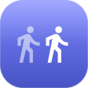
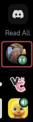
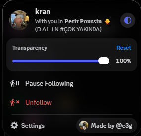

<div align="center">



# Follow User

**Follow a friend from voice channel to voice channel, automatically.**

A [Vencord](https://github.com/Vendicated/Vencord) plugin. Pick a user, and whenever they join or switch voice channels, you join with them.

[](LICENSE)
[](https://github.com/Vendicated/Vencord)

</div>

## Features

| | Feature | What it does |
|:---:|---|---|
|  | **Auto follow** | Joins the voice channel of the user you follow every time they move |
|  | **Indicator** | Shows who you follow and where they are, at the top of your server list |
|  | **Smart pause** | Leave their channel yourself and following pauses. Join them again and it resumes |
|  | **Notifications** | Tells you when they join a voice channel while following is paused |
|  | **Follow leave** | Disconnects you when they disconnect *(optional)* |
|  | **Move back** | Takes you back to them if someone moves you to another channel *(optional)* |
|  | **Full channels** | Waits for a free spot in their full channel and joins as soon as one opens |
|  | **Safe** | Never tries to join a channel you have no permission for, and tells you why |

## How to use

### 1. Follow someone

Right-click a user anywhere (chat, member list or voice channel) and click **Follow User**.
If they are already in a voice channel, you join them right away.


To stop, right-click them again and click **Unfollow User**. You can follow one user at a time.

### 2. Check the indicator

The user you follow now appears at the top of your server list.



| You see | It means |
|---|---|
| Green badge | They are in a voice channel and you are following them |
| Dark badge | They are not in a voice channel you can see |
| Faded picture, ❚❚ on the badge | Following is paused |

**Hover** it to see which channel they are in. **Click** it to join them right now.

### 3. Open the panel

Right-click the indicator to open its panel. At the top you see who you follow and which channel they are in.



| Option | What it does |
|---|---|
| **Join Now** | Joins their channel right now (only shown when you are not together) |
| **Pause / Resume Following** | Stops following for a while, without forgetting the user |
| **Unfollow** | Stops following and removes the indicator |
| **Settings** | Opens the plugin settings |
| **◐** at the top right | Opens a slider that sets how see-through the panel is. **Reset** returns it to 65% |

Press **Esc** or click outside the panel to close it.

## Settings

Open them from the indicator's panel, or from **Vencord → Plugins → Follow User**.

| Setting | Default | What it does |
|---|:---:|---|
| **Execute On Follow** | On | Join their channel as soon as you start following |
| **Only Manual Trigger** | Off | Never move automatically. Only join when you click the indicator |
| **Follow Leave** | Off | Disconnect when they disconnect |
| **Auto Move Back** | Off | Go back to them when someone moves you |
| **Channel Full** | On | Join their channel when a spot opens up |
| **Notify On Join** | On | Notify you when they join a channel while following is paused or manual. Click the notification to join |
| **Transparency** | 65% | How see-through the panel and tooltip are. 0% makes them solid. The panel's ◐ button sets the same value |


## Installation

> [!IMPORTANT]
> This is a **user plugin**, so it is not part of the regular Vencord download. You have to build Vencord yourself once.
> Official guide: [Installing custom plugins](https://docs.vencord.dev/installing/custom-plugins/)

You need [Git](https://git-scm.com/downloads), [Node.js](https://nodejs.org/) and [pnpm](https://pnpm.io/installation).

**1.** Download Vencord *(skip if you already have it)*

```sh
git clone https://github.com/Vendicated/Vencord
cd Vencord
pnpm install --frozen-lockfile
```

**2.** Add the plugin

```sh
cd src/userplugins
git clone https://github.com/cegged/Follow-User
cd ../..
```

**3.** Build and install into Discord

```sh
pnpm build
pnpm inject
```

**4.** Restart Discord and turn on **Follow User** in **Vencord → Plugins**.

### Updating

```sh
cd Vencord/src/userplugins/Follow-User
git pull
cd ../../..
pnpm build
```

Then restart Discord.

## FAQ

<details>
<summary><b>It says the user is not in voice, but they are</b></summary>
<br>

Discord only shows you voice channels in servers you share with that user. If they are in a server you are not in, the plugin can't see them.

</details>

<details>
<summary><b>It stopped following after I left the channel</b></summary>
<br>

That's smart pause. Click the indicator or join their channel to resume.

</details>

<details>
<summary><b>It doesn't join their channel</b></summary>
<br>

The channel is full, or you don't have permission to join it. A message at the bottom of the screen tells you which.

</details>

<details>
<summary><b>Is the followed user saved after a restart?</b></summary>
<br>

Yes. The user you follow and the pause state are kept after restarting Discord.

</details>

---

<div align="center">

Made by **cegged** · [GitHub](https://github.com/cegged) · Discord `@c3g`

Found a bug or have an idea? [Open an issue](https://github.com/cegged/Follow-User/issues)

Licensed under [GPL-3.0-or-later](LICENSE)

</div>
